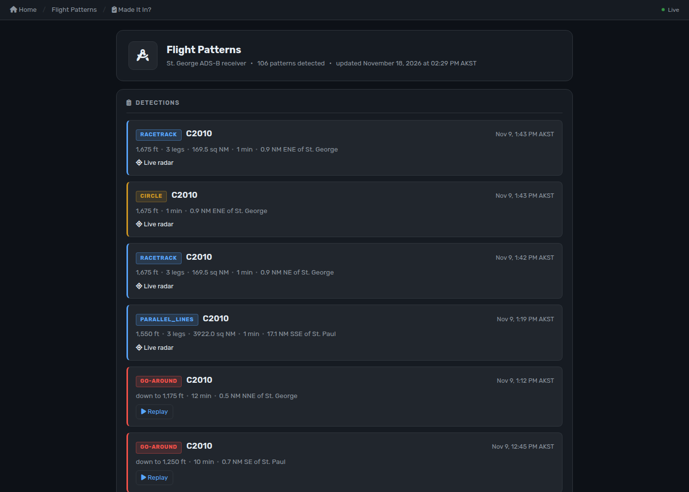
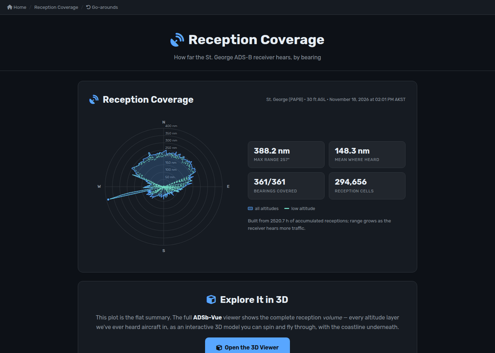
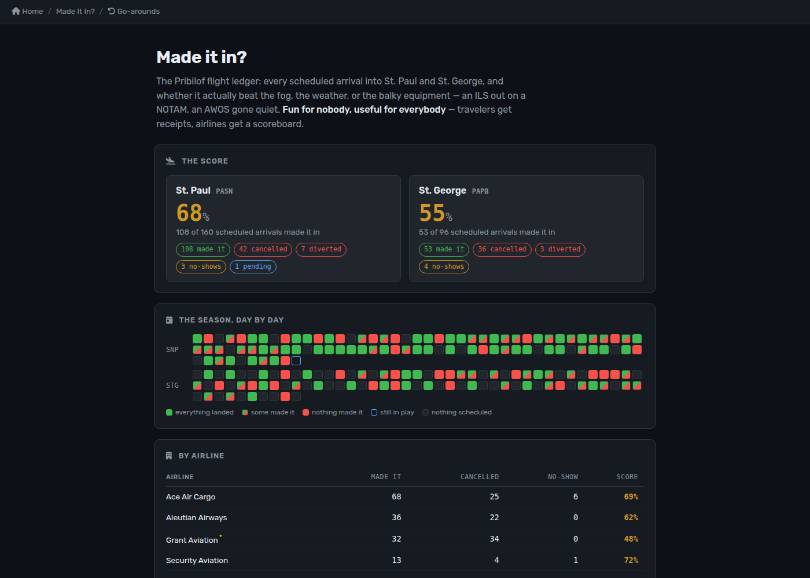

# aviation-collectors

One small container that turns an ADS-B receiver into a set of JSON files a
website can read: a history of every aircraft heard, which scheduled flights
actually landed, go-arounds and holds, and how far the antenna hears.

It was built for [pribiloftraffic.com](https://www.pribiloftraffic.com), which
watches two island airports in the Bering Sea. Nothing in the code names those
airports any more: you describe your own in one file and put your addresses in
`.env`.

## On pribiloftraffic.com

[Flight patterns](https://www.pribiloftraffic.com/flightpatterns/) is the
go-arounds and holds. [Reception coverage](https://www.pribiloftraffic.com/reception/)
is how far the St. George antenna hears. [Made it in?](https://www.pribiloftraffic.com/madeit/)
is the arrival ledger, checked against that antenna.

The same files also feed [St. Paul flights](https://www.pribiloftraffic.com/myflightsnp/),
[St. George flights](https://www.pribiloftraffic.com/myflightstg/), both approach
pages, and [the Armchair Dispatcher](https://www.pribiloftraffic.com/armchair/).

As those pages looked on the afternoon of 18 Nov 2026.







The Docker setup on the island started from the SDR Enthusiasts guide,
[ADS-B Reception, Decoding & Sharing with Docker](https://sdr-enthusiasts.gitbook.io/ads-b).

## What it does

Only the first row is required. Each of the others switches on when you give
it the setting in the last column.

| Job | Default interval | Writes | Needs |
|---|---|---|---|
| Aircraft history | 60 s | `adsb_history.db` (SQLite, one row per aircraft per poll) | `AVIATION_TAR1090_URL` |
| Go-arounds and holds | 5 min | `flight_patterns.json`, with a track for each event | airports in `site.json` |
| Aircraft counts | 6 h | `aircraft_stats.json` | the history database |
| Scheduled arrivals and the arrival ledger | 2 h | `flight_plans_<icao>.json`, `flight_record_<icao>.json` | `AVIATION_FA_AEROAPI_KEY` |
| "Heard departing" from the hub airport | 2 min | `<hub>_departures.json` | `AVIATION_HUB_TAR1090_URL` |
| Reception range | 30 min | `adsb_coverage.json` | `AVIATION_COVERAGE_URL` (ADSb-Vue) |
| Dated backups | daily | `<backup dir>/YYYY-MM-DD/` | `AVIATION_BACKUP_DIR` |

It also writes `aviation_status.json`: what each job last did, and when.

**The arrival ledger does not take FlightAware's word for it.** FlightAware
sometimes reports a go-around as a landing, or loses a flight that diverted.
For every finished day the ledger asks your own history database whether the
aircraft was seen low near the field and then went quiet (it landed) or
climbed back out (it did not), and that verdict wins.

## What you need

- Docker with Compose.
- An ADS-B receiver that serves `aircraft.json` (tar1090, readsb, dump1090-fa)
  at an address this machine can reach.
- Optional: a FlightAware AeroAPI key. Polls are billed; two airports at the
  default interval come to about $7 a month.

## Set it up

1. **Get the code.**

   ```
   git clone https://github.com/PribilofTraffic/aviation-collectors.git aviation
   ```

2. **Describe your airports.** Copy the example and edit it:

   ```
   cp aviation/config/site.example.json aviation/config/site.json
   ```

   | Key | Meaning |
   |---|---|
   | `timezone` | Your local zone, such as `America/Anchorage`. It decides what "today" is. Set it once and do not change it later: the history database stores local times. |
   | `airports` | One entry per airport: `icao`, `name`, `lat`, `lon`. `short_name` is what the feeds call it in sentences. `place` is optional: a nearby point to measure "13 NM S of ..." from, if you would rather not use the runway. |
   | `hub` | Optional. The airport your scheduled flights leave from (`icao`, `name`). |
   | `coverage_site` | Optional. A name and ICAO stamped on the reception-range feed. |
   | `radar_link` | Optional. A link to your live radar page for one aircraft, with `{hex}`, `{lat}`, `{lon}` and `{zoom}` filled in per event. Without it events carry no radar link. |
   | `excluded_ident_prefixes` | Optional. Callsign prefixes that are never a scheduled arrival, such as flight-inspection aircraft. |
   | `operator_display_names` | Optional. Names for three-letter operator codes, such as `"AER": "Ace Air Cargo"`. |
   | `timetable` | Optional. See "An operator that does not file" below. |

3. **Add the settings.** Copy the lines you need from `aviation/.env.example`
   into the `.env` beside your `docker-compose.yml`. At minimum:

   ```
   AVIATION_TAR1090_URL=http://<your receiver>/data/aircraft.json
   AVIATION_DATA_DIR=./aviation/data
   AVIATION_CONFIG_DIR=./aviation/config
   AVIATION_UID=1000
   AVIATION_GID=1000
   ```

4. **Add the service** to your `docker-compose.yml`:

   ```yaml
   services:
     aviation:
       build: ./aviation
       container_name: aviation
       restart: always
       user: "${AVIATION_UID}:${AVIATION_GID}"
       environment:
         - AVIATION_TAR1090_URL=${AVIATION_TAR1090_URL}
         - AVIATION_HUB_TAR1090_URL=${AVIATION_HUB_TAR1090_URL:-}
         - AVIATION_PATTERNS_URL=${AVIATION_PATTERNS_URL:-}
         - AVIATION_COVERAGE_URL=${AVIATION_COVERAGE_URL:-}
         - AVIATION_FA_AEROAPI_KEY=${AVIATION_FA_AEROAPI_KEY:-}
         - AVIATION_FLIGHTS_INTERVAL=${AVIATION_FLIGHTS_INTERVAL:-7200}
         - AVIATION_BACKUP_KEEP=${AVIATION_BACKUP_KEEP:-3}
         - AVIATION_BACKUP_DIR=${AVIATION_BACKUP_DIR:+/backups}
       volumes:
         - ${AVIATION_DATA_DIR}:/data
         - ${AVIATION_CONFIG_DIR}:/config:ro
         - ${AVIATION_BACKUP_DIR:-./aviation/backups}:/backups
       mem_limit: 256m
   ```

   Only the settings named here reach the container, so anything else in your
   `.env` stays out of it. Inside the container the three folders are always
   `/data`, `/config` and `/backups`; `.env` holds where they are on your
   machine. To change another interval, add its line the same way.

5. **Start it and look.**

   ```
   docker compose up -d --build aviation
   docker compose logs -f aviation
   ```

   The first lines list every job as `every N s` or `off (not configured)`.
   Within a minute you should see `Collected N aircraft, stored N records`.

## Checking it is working

- `docker ps` shows the container as `healthy`. Healthy means the main loop is
  running. It stays healthy when your receiver is down, because restarting the
  container would not bring the receiver back.
- `data/aviation_status.json` says what each job last did. A receiver that has
  stopped answering shows up there as `receiver gave no aircraft data`.

## Naming your aircraft (optional)

Put a `known_aircraft.json` in your config folder to turn tail numbers and
operator codes into names. `config/known_aircraft.example.json` shows the
shape. An operator that files as its code plus the last three characters of a
tail, while the aircraft broadcasts the full tail, is matched through this
file (`GUN5SR` is heard as `N55SR`).

## An operator that does not file

Some small operators post a weekly timetable but rarely file a flight plan, so
FlightAware never lists them. Name that operator in `site.json` and keep its
timetable in a hand-edited file in the data folder:

```json
"timetable": { "operator": "Grant Aviation", "file": "grant_schedule.json" }
```

```json
{ "airports": { "PASN": { "days": ["Sunday", "Tuesday", "Thursday", "Friday"] } } }
```

The ledger then scores each timetable day from your antenna: did one of that
operator's tail numbers land. The result is stored under the keys `grant_days`
and `summary.grant`, named after the operator this was written for.

## Using the code outside the container

`app/` is plain Python with one dependency (`requests`). A script on the host
can import `plane_day`, `adsb_ground_truth` and the rest directly. With no
environment set, `app/settings.py` reads the `.env` in the folder above this
repository, so the host script and the container use the same values. Set
`AVIATION_ENV_FILE` to point somewhere else.

## Things to know

- **One writer.** Never run two copies against the same `adsb_history.db`.
- **No backfill.** A receiver keeps no history, and neither does a personal
  FlightAware plan. A minute or a day the container did not run is gone, which
  is why the backups exist.
- **Restarts do not cost money.** Last-run times are saved in the data folder,
  so a restart does not trigger an extra FlightAware poll.
- **The code comments tell real stories** from the original site (flight
  numbers, dates, an antenna in the Pribilof Islands). They are kept because
  each explains why a rule is the way it is.

## How the original site is wired up

On pribiloftraffic.com the pieces are in different places, which is common:

- **The receivers are Raspberry Pis on the islands.** The server that runs
  this container is somewhere else. They are joined by
  [ZeroTier](https://www.zerotier.com/), a private network, so the container
  reads `aircraft.json` from each Pi's ZeroTier address.
- **nginx serves the website** as plain files. The JSON this container writes
  is made visible to it either by pointing the data folder at a folder nginx
  already serves, or with an nginx `alias`. The pages then fetch
  `/data/flight_patterns.json` and the rest like any other file.
- **nginx also reverse-proxies the receivers' own web pages** (tar1090 and
  friends) under paths on the site, because a visitor's browser cannot reach
  a private address. That is for the live map; this container does not need
  it.
- **Cloudflare sits in front** for HTTPS and caching.

None of this is required. The container only needs an address it can reach
and a folder to write to.

- **Any private network will do in place of ZeroTier:** Tailscale, NetBird,
  Headscale or plain WireGuard. Docker containers go out through the host, so
  whatever the host can reach, the container can reach. With Tailscale, put
  the device's `100.x.x.x` address in `.env`; its device names often do not
  resolve inside a container.
- **Any web server will do in place of nginx.** It only has to serve the
  files in the data folder. Nothing here needs to be proxied.

## Tests

```
python3 -m unittest discover -s tests
```

188 tests, run against recordings of real days. They use the example site
file, so they need no setup.

## Licence

MIT. See `LICENSE`.
